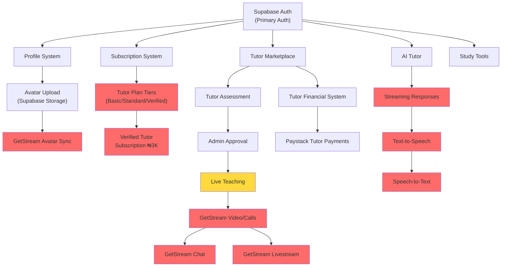

# STUDORA — PHASE 0 ARCHITECTURE AUDIT

> **Generated**: 2026-10-16 • **Mode**: Read-only • **No files modified**

---

## Table of Contents

1. [Existing Architecture & File Paths](#1-existing-architecture--file-paths)
2. [Feature Status Matrix](#2-feature-status-matrix)
3. [Database Tables, Migrations, RPCs & Policies](#3-database-tables-migrations-rpcs--policies)
4. [Security Gaps & Integration Risks](#4-security-gaps--integration-risks)
5. [Missing Environment Variable Names](#5-missing-environment-variable-names)
6. [Feature Dependencies](#6-feature-dependencies)
7. [Phased Implementation Plan](#7-phased-implementation-plan)
8. [Test & Build Commands](#8-test--build-commands)
9. [Recording Limits](#9-recording-limits)

---

## 1. Existing Architecture & File Paths

### 1.1 Application Structure

```
Academic-platform/
├── src/                          # Main student-facing SPA (Vite + React 18)
│   ├── main.jsx                  # App entry point
│   ├── App.jsx                   # Root router + layout (1000+ LOC)
│   ├── components/
│   │   ├── billing/              # FeatureGate, UpgradePrompt
│   │   ├── common/               # ErrorBoundary, Footer, NotFound, PageLoader
│   │   ├── legal/                # ConsentBanner, CookieSettingsModal
│   │   ├── navigation/           # BottomNav, Sidebar, TopHeader
│   │   ├── tutor/                # BookingModal
│   │   └── ui/                   # Avatar, Button, Card, Modal, Toast, etc.
│   ├── config/clientConfig.js    # Centralized client env config
│   ├── context/BillingContext.jsx # Billing state provider
│   ├── hooks/
│   │   ├── useTutorApplication.js
│   │   └── useTutorMarketplace.js
│   ├── lib/supabase/client.js    # Supabase browser client
│   ├── pages/
│   │   ├── auth/AuthPage.jsx     # Login/register (supports Supabase + Firebase)
│   │   ├── billing/              # PricingPage, SubscriptionPage, CallbackPage
│   │   ├── cgpa/CgpaPage.jsx     # CGPA calculator
│   │   ├── dashboard/DashboardPage.jsx
│   │   ├── landing/LandingPage.jsx
│   │   ├── legal/                # Privacy, Terms, Cookie pages
│   │   ├── profile/ProfilePage.jsx
│   │   ├── study/                # AiTutorPage, StudyPlannerPage
│   │   └── tutor/                # BecomeTutor, TutorDashboard, Marketplace, Earnings
│   └── services/
│       ├── academic/cgpaEngine.js
│       ├── api/client.js         # API client wrapper
│       ├── firebase/firebaseConfig.js
│       └── storage/platformStore.js  # PGlite in-browser store
│
├── server/                       # Express-based API (Node.js ESM)
│   ├── index.js                  # HTTP server entry
│   ├── api.js                    # All API route handlers (1444 LOC)
│   ├── db.js                     # PGlite database + schema seeding (842 LOC)
│   ├── billing-service.js        # Paystack subscription billing (766 LOC)
│   ├── tutor-financial-service.js # Tutor payment/payout via Supabase RPCs (745 LOC)
│   ├── ai-tutor-service.js       # xAI Grok integration + fallback (196 LOC)
│   ├── firebase-auth.js          # Firebase ID token verification
│   └── zego.js                   # ZEGOCLOUD Token04 generation (157 LOC)
│
├── admin/                        # Separate admin panel SPA (Vite + React)
│   └── src/
│       ├── App.jsx               # Admin router
│       ├── components/           # AdminGuard, AdminSidebar
│       ├── context/AdminAuthContext.jsx
│       ├── layouts/AdminLayout.jsx
│       ├── lib/supabase.js       # Admin Supabase client
│       └── pages/                # Login, Dashboard, Applications, Review, Payments
│
├── supabase/                     # Supabase project config + migrations
│   ├── config.toml
│   ├── seed.sql
│   ├── migrations/               # 9 migration files
│   └── tests/                    # RLS verification scripts
│
├── api/                          # Vercel serverless functions
│   ├── index.js                  # Main serverless handler
│   └── [...all].js               # Catch-all route
│
├── vercel.json                   # Deployment config
├── package.json                  # Root dependencies
└── .env.example                  # Environment template
```

### 1.2 Dual Database Architecture

> [!WARNING]
> The codebase operates **two parallel database systems**:
> 1. **PGlite** (in-browser/embedded PostgreSQL) — used by `server/db.js` for the Express API layer
> 2. **Supabase** (hosted PostgreSQL) — used by migrations, RPCs, RLS policies, and the admin panel

The server's `db.js` initializes its own PGlite schema (users, profiles, subscriptions, etc.) which **duplicates** much of the Supabase migration schema. The tutor financial service (`tutor-financial-service.js`) bridges both by calling **Supabase RPCs** for financial mutations while the rest of the Express API uses PGlite.

### 1.3 Authentication Architecture

Three auth mechanisms coexist:
1. **Supabase Auth** (primary) — JWT with `aud: 'authenticated'`
2. **Firebase Auth** (legacy) — ID token verification via `firebase-auth.js`
3. **HMAC Session Tokens** (legacy) — custom `HS256` tokens via `APP_SECRET`

The `getAuthenticatedUser()` function in `server/api.js` (L66-189) cascades through all three.

### 1.4 Build & Dev Commands

| Command | Source | Purpose |
|---------|--------|---------|
| `npm run dev` | `package.json` | Vite dev server (main app) |
| `npm run build` | `package.json` | `vite build` (production) |
| `npm run preview` | `package.json` | Preview production build |

> [!NOTE]
> Admin panel has its own `admin/package.json` with separate Vite config but no scripts observed in root.

### 1.5 Vercel Deployment

[`vercel.json`](file:///home/aziel/Desktop/Academic-platform/vercel.json):
- `/api/(.*)` → `/api` (serverless function)
- `/((?!api/).*)` → `/index.html` (SPA fallback)

---

## 2. Feature Status Matrix

### Legend
| Status | Meaning |
|--------|---------|
| ✅ IMPLEMENTED | Feature is code-complete and functional |
| 🟡 PARTIAL | Core exists but missing key integrations |
| ❌ MISSING | Not yet implemented |
| 🔴 BROKEN | Implemented but has blocking issues |
| ⏸️ UNDECIDED | Product decision not yet made |

### 2.1 GetStream Migration

| Feature | Status | Evidence |
|---------|--------|----------|
| GetStream SDK installed | ❌ MISSING | No `stream-chat`, `@stream-io/*`, or `getstream` in any `package.json` |
| GetStream chat integration | ❌ MISSING | Zero GetStream references in entire codebase |
| GetStream video/calls | ❌ MISSING | No `StreamVideo`, `StreamCall` references found |
| GetStream livestreaming | ❌ MISSING | No livestream code exists |
| GetStream token generation | ❌ MISSING | No server-side Stream token endpoint |
| GetStream user sync | ❌ MISSING | No Stream user creation/update code |
| GetStream avatar sync | ❌ MISSING | No avatar → Stream synchronization |
| ZEGOCLOUD Token04 generation | ✅ IMPLEMENTED | [`server/zego.js`](file:///home/aziel/Desktop/Academic-platform/server/zego.js) — full Token04 generator |
| ZEGOCLOUD video token API | ✅ IMPLEMENTED | [`server/api.js`](file:///home/aziel/Desktop/Academic-platform/server/api.js#L1333-L1410) — `POST /api/video/token` |
| ZEGOCLOUD client SDK | ✅ IMPLEMENTED | `@zegocloud/zego-uikit-prebuilt@^2.18.4` in `package.json` |
| ZEGOCLOUD UI references | ✅ IMPLEMENTED | Feature gate in `App.jsx`, pricing pages, FAQ sections |

> [!IMPORTANT]
> **GetStream is completely absent.** The entire real-time communication stack is ZEGOCLOUD. Migration requires: installing Stream SDKs, implementing token generation, building chat/video UI, syncing users, and removing all ZEGOCLOUD code.

### 2.2 Tutor Marketplace

| Feature | Status | Evidence |
|---------|--------|----------|
| Tutor application form | ✅ IMPLEMENTED | [`BecomeTutorPage.jsx`](file:///home/aziel/Desktop/Academic-platform/src/pages/tutor/BecomeTutorPage.jsx) — multi-step wizard |
| Subject selection | ✅ IMPLEMENTED | Subject picker with assessment in application flow |
| Tutor profile (Supabase) | ✅ IMPLEMENTED | `tutor_profiles` table with `approval_status` enum |
| Tutor assessment system | ✅ IMPLEMENTED | `tutor_subject_assessments` table + RPCs (`start_tutor_assessment`, etc.) |
| Admin application review | ✅ IMPLEMENTED | [`ApplicationsPage.jsx`](file:///home/aziel/Desktop/Academic-platform/admin/src/pages/ApplicationsPage.jsx), [`ApplicationReviewPage.jsx`](file:///home/aziel/Desktop/Academic-platform/admin/src/pages/ApplicationReviewPage.jsx) |
| Admin approval workflow | ✅ IMPLEMENTED | RPC `admin_review_application` with status transitions |
| Tutor marketplace listing | ✅ IMPLEMENTED | [`TutorMarketplacePage.jsx`](file:///home/aziel/Desktop/Academic-platform/src/pages/tutor/TutorMarketplacePage.jsx) — search, filter, sort |
| Tutor dashboard | ✅ IMPLEMENTED | [`TutorDashboardPage.jsx`](file:///home/aziel/Desktop/Academic-platform/src/pages/tutor/TutorDashboardPage.jsx) |
| Booking modal | ✅ IMPLEMENTED | [`BookingModal.jsx`](file:///home/aziel/Desktop/Academic-platform/src/components/tutor/BookingModal.jsx) |
| Booking payment flow | ✅ IMPLEMENTED | `POST /api/tutors/booking/initialize` + Supabase RPC |
| Tutor earnings section | ✅ IMPLEMENTED | [`EarningsSection.jsx`](file:///home/aziel/Desktop/Academic-platform/src/pages/tutor/EarningsSection.jsx) |
| Payout setup | ✅ IMPLEMENTED | [`PayoutSetupSection.jsx`](file:///home/aziel/Desktop/Academic-platform/src/pages/tutor/PayoutSetupSection.jsx) |
| Live teaching (video) | 🟡 PARTIAL | ZEGOCLOUD token endpoint exists; no in-app video UI for teaching sessions |
| Recorded lessons | ❌ MISSING | No upload, storage, or playback for recorded lessons |
| Lesson publishing | ❌ MISSING | No lesson content publishing system |
| Tutor plan tiers (Basic/Standard/Verified) | ❌ MISSING | No tutor-specific plan tiers exist; only student plans |
| Verified tutor subscription (₦3,000/mo) | ❌ MISSING | No `verified` plan or tutor subscription table |

### 2.3 Subscriptions & Billing

| Feature | Status | Evidence |
|---------|--------|----------|
| Subscription plans table | ✅ IMPLEMENTED | `subscription_plans` in both PGlite and Supabase |
| Feature definitions | ✅ IMPLEMENTED | `feature_definitions` — 15 features defined |
| Plan entitlements matrix | ✅ IMPLEMENTED | `plan_entitlements` — Basic/Student/Pro/Premium |
| User subscriptions | ✅ IMPLEMENTED | `user_subscriptions` with lifecycle states |
| Paystack checkout | ✅ IMPLEMENTED | [`billing-service.js`](file:///home/aziel/Desktop/Academic-platform/server/billing-service.js#L366-L450) |
| Paystack verification | ✅ IMPLEMENTED | `verifyPayment()` in billing-service.js |
| Paystack webhooks | ✅ IMPLEMENTED | `handlePaystackWebhook()` — charge.success, subscription.*, invoice.failed |
| Webhook HMAC verification | ✅ IMPLEMENTED | SHA512 signature verification |
| Webhook idempotency | ✅ IMPLEMENTED | `payment_webhook_events` with `event_id` uniqueness |
| Usage tracking | ✅ IMPLEMENTED | `subscription_usage` with atomic upsert |
| Feature gating (frontend) | ✅ IMPLEMENTED | `FeatureGate.jsx`, `BillingContext.jsx` |
| Feature gating (backend) | ✅ IMPLEMENTED | `atomicIncrementUsage()` on AI, test prep, video endpoints |
| Billing history | ✅ IMPLEMENTED | `getBillingHistory()` + UI |
| Subscription cancellation | ✅ IMPLEMENTED | `cancelSubscription()` — grace period until end |
| Admin billing metrics | ✅ IMPLEMENTED | `getAdminBillingMetrics()` + admin UI |
| Tutor session payments | ✅ IMPLEMENTED | `tutor-financial-service.js` + Supabase RPCs |
| Tutor payouts | ✅ IMPLEMENTED | Paystack Transfers via `executeTutorPayout()` |
| Tutor earnings tracking | ✅ IMPLEMENTED | `tutor_session_ledger` + `get_tutor_earnings_summary()` RPC |
| Withdrawal requests | ✅ IMPLEMENTED | `request_tutor_withdrawal()` + admin approval flow |
| **Tutor plan tiers** | ❌ MISSING | No Free Basic / Standard / Verified tutor plans |
| **Verified tutor subscription** | ❌ MISSING | No ₦3,000/mo tutor subscription |

> [!IMPORTANT]
> **Current student plans**: Basic (₦0), Student (₦2,500), Pro (₦5,000), Premium (₦10,000).
> **Confirmed product decisions require**: Tutor-specific plans (Free Basic, paid Standard) plus a separate Verified subscription (₦3,000/mo). None of these exist.

### 2.4 AI Tutor & Voice

| Feature | Status | Evidence |
|---------|--------|----------|
| LLM provider | ✅ IMPLEMENTED | **xAI Grok** (`grok-2-latest`) via [`ai-tutor-service.js`](file:///home/aziel/Desktop/Academic-platform/server/ai-tutor-service.js) |
| Multi-turn conversation | ✅ IMPLEMENTED | Conversation history passed to Grok API |
| Conversation persistence | ✅ IMPLEMENTED | `ai_chat_conversations` + `ai_chat_messages` tables |
| Conversation UI | ✅ IMPLEMENTED | [`AiTutorPage.jsx`](file:///home/aziel/Desktop/Academic-platform/src/pages/study/AiTutorPage.jsx) |
| Conversation list/history | ✅ IMPLEMENTED | `GET /api/ai/conversations` |
| Fallback engine | ✅ IMPLEMENTED | Academic response generator when no API key |
| System prompt | ✅ IMPLEMENTED | Pedagogical tutor instruction |
| Usage tracking | ✅ IMPLEMENTED | `AI_TUTOR` feature code with plan limits |
| Subscription enforcement | ✅ IMPLEMENTED | `atomicIncrementUsage('AI_TUTOR')` on each query |
| **Streaming responses** | ❌ MISSING | Uses non-streaming `POST` to Grok API |
| **Speech-to-text (STT)** | ❌ MISSING | No microphone input, no Whisper/recognition |
| **Text-to-speech (TTS)** | ❌ MISSING | No SpeechSynthesis, no ElevenLabs, no voice output |
| **Voice controls** | ❌ MISSING | No mute/text-mode toggle |
| **Spoken response default** | ❌ MISSING | Responses are text-only |

> [!IMPORTANT]
> Per confirmed product decisions, AI tutor should have **spoken responses by default** with text and mute controls. Currently the AI is text-only with no voice capabilities.

### 2.5 Student Learning & Assessments

| Feature | Status | Evidence |
|---------|--------|----------|
| CGPA calculator | ✅ IMPLEMENTED | [`CgpaPage.jsx`](file:///home/aziel/Desktop/Academic-platform/src/pages/cgpa/CgpaPage.jsx) + `cgpaEngine.js` |
| Multi-scale grading (5.0, 4.0, 7.0) | ✅ IMPLEMENTED | `grading_scales` table with seeded scales |
| Semester management | ✅ IMPLEMENTED | CRUD + duplicate semesters |
| Course management | ✅ IMPLEMENTED | CRUD with grade tracking |
| Study planner | ✅ IMPLEMENTED | [`StudyPlannerPage.jsx`](file:///home/aziel/Desktop/Academic-platform/src/pages/study/StudyPlannerPage.jsx) |
| Study topics/checklist | ✅ IMPLEMENTED | `study_topics` with toggle completion |
| Study streak tracking | ✅ IMPLEMENTED | `study_logs` + streak calculation |
| Dashboard | ✅ IMPLEMENTED | [`DashboardPage.jsx`](file:///home/aziel/Desktop/Academic-platform/src/pages/dashboard/DashboardPage.jsx) |
| Test prep entitlement | ✅ IMPLEMENTED | `TEST_PREP_BASIC` / `TEST_PREP_ADVANCED` features |
| Tutor subject assessments | ✅ IMPLEMENTED | Assessment tables + RPCs (tutor-side) |
| **Examination simulator** | ❌ MISSING | No question engine, no timed exams, no scoring |
| **Question banks** | ❌ MISSING | No question storage or management |
| **Past questions** | ❌ MISSING | No past question upload/display |
| **PDF handling** | ❌ MISSING | No PDF upload, viewer, or storage |
| **Tutorial videos** | ❌ MISSING | No video content management |
| **Progress analytics** | 🟡 PARTIAL | Study hours tracked; no grade-trend analysis |

### 2.6 Profiles & Security

| Feature | Status | Evidence |
|---------|--------|----------|
| User profiles | ✅ IMPLEMENTED | `profiles` table (Supabase + PGlite) |
| Avatar URL field | ✅ IMPLEMENTED | `avatar_url` column in `profiles` |
| Avatar component | ✅ IMPLEMENTED | [`Avatar.jsx`](file:///home/aziel/Desktop/Academic-platform/src/components/ui/Avatar.jsx) |
| Profile page | ✅ IMPLEMENTED | [`ProfilePage.jsx`](file:///home/aziel/Desktop/Academic-platform/src/pages/profile/ProfilePage.jsx) |
| Profile update API | ✅ IMPLEMENTED | `PUT /api/profile` with avatar_url |
| Supabase Storage bucket | ✅ IMPLEMENTED | `avatars` bucket in migration `20261006010000` |
| Storage RLS policies | ✅ IMPLEMENTED | Public read, authenticated upload/update/delete (own folder) |
| Supabase RLS on tables | ✅ IMPLEMENTED | Comprehensive policies across all tables |
| Admin guard | ✅ IMPLEMENTED | [`AdminGuard.jsx`](file:///home/aziel/Desktop/Academic-platform/admin/src/components/AdminGuard.jsx) |
| `is_admin()` function | ✅ IMPLEMENTED | Supabase function checking admin role |
| Tutor approval boundaries | ✅ IMPLEMENTED | `admin_review_application` RPC with state machine |
| Data export (GDPR) | ✅ IMPLEMENTED | `GET /api/auth/export-data` |
| Account deletion | ✅ IMPLEMENTED | `DELETE /api/auth/account` with cascade |
| Consent tracking | ✅ IMPLEMENTED | `consent_records` table |
| **GetStream avatar sync** | ❌ MISSING | No GetStream integration exists |
| **Profile picture upload UI** | 🟡 PARTIAL | Avatar field exists; upload flow unclear in profile page |

---

## 3. Database Tables, Migrations, RPCs & Policies

### 3.1 Supabase Migrations (Ordered)

| # | Migration | Purpose |
|---|-----------|---------|
| 1 | `20261001000000_studora_core_schema.sql` | Core tables: grading_scales, subscription_plans, feature_definitions, plan_entitlements, profiles, user_settings, semesters, student_courses, study_plans, study_topics, study_logs, consent_records, user_subscriptions, payment_transactions, payment_webhook_events, subscription_usage, ai_chat_conversations, ai_chat_messages |
| 2 | `20261001010000_studora_auth_roles_and_tutoring.sql` | Roles, `is_admin()` function, tutor_profiles, tutor_subjects, tutor_availability, tutor_bookings, RLS policies |
| 3 | `20261002000000_studora_tutor_platform_and_assessment.sql` | `tutor_subject_assessments`, assessment RPCs (`start_tutor_assessment`, `submit_assessment_answer`, `complete_tutor_assessment`), tutor marketplace RPCs |
| 4 | `20261005000000_drop_legacy_tutor_profiles_select_policy.sql` | Drops legacy policy |
| 5 | `20261005010000_fix_start_tutor_assessment_union_order_by.sql` | Fixes SQL ordering bug |
| 6 | `20261005020000_fix_application_state_protection.sql` | Fixes state transition protection |
| 7 | `20261005030000_phase55_strict_subject_assessment.sql` | Stricter assessment rules |
| 8 | `20261006000000_studora_financial_system.sql` | Financial system: platform_config, tutor_payout_profiles, session_price on tutor_profiles, tutor_session_ledger, tutor_withdrawals + 10 RPCs |
| 9 | `20261006010000_studora_avatars_storage.sql` | `avatars` storage bucket + 4 RLS policies |

### 3.2 Key Supabase Tables

| Table | Schema | PK Type | RLS |
|-------|--------|---------|-----|
| `profiles` | public | UUID (→ auth.users) | ✅ |
| `tutor_profiles` | public | UUID (→ profiles) | ✅ |
| `tutor_subjects` | public | UUID | ✅ |
| `tutor_availability` | public | UUID | ✅ |
| `tutor_bookings` | public | UUID | ✅ |
| `tutor_subject_assessments` | public | UUID | ✅ |
| `tutor_payout_profiles` | public | UUID (→ profiles) | ✅ |
| `tutor_session_ledger` | public | UUID | ✅ |
| `tutor_withdrawals` | public | UUID | ✅ |
| `platform_config` | public | TEXT | ✅ |
| `subscription_plans` | public | TEXT | ✅ |
| `feature_definitions` | public | TEXT | ✅ |
| `plan_entitlements` | public | TEXT | ✅ |
| `user_subscriptions` | public | TEXT | — |
| `payment_transactions` | public | TEXT | — |
| `payment_webhook_events` | public | TEXT | — |
| `subscription_usage` | public | TEXT | — |
| `grading_scales` | public | TEXT | ✅ |
| `semesters` | public | TEXT | ✅ |
| `student_courses` | public | TEXT | ✅ |
| `study_plans` | public | TEXT | ✅ |
| `study_topics` | public | TEXT | ✅ |
| `study_logs` | public | TEXT | ✅ |
| `consent_records` | public | TEXT | ✅ |
| `ai_chat_conversations` | public | TEXT | ✅ |
| `ai_chat_messages` | public | TEXT | ✅ |
| `user_settings` | public | TEXT | ✅ |

### 3.3 Key Supabase RPCs

| RPC | Purpose |
|-----|---------|
| `is_admin(uid)` | Check admin role |
| `start_tutor_assessment(...)` | Begin subject assessment |
| `submit_assessment_answer(...)` | Submit answer during assessment |
| `complete_tutor_assessment(...)` | Finalize assessment + scoring |
| `admin_review_application(...)` | Admin approve/reject tutor |
| `get_platform_commission()` | Read platform commission rate |
| `calculate_session_split(amount)` | Compute tutor/platform split |
| `set_tutor_session_price(price)` | Set tutor hourly rate |
| `initialize_booking_payment(...)` | Create booking + payment record |
| `confirm_session_payment(ref)` | Mark payment confirmed |
| `complete_booking_and_release_earning(...)` | Release earning to tutor |
| `get_tutor_earnings_summary()` | Tutor's financial dashboard data |
| `request_tutor_withdrawal(amount)` | Request payout |
| `admin_approve_withdrawal(id)` | Admin approves withdrawal |
| `reverse_session_earning(ledger_id)` | Reverse/refund an earning |

### 3.4 Key Triggers

| Trigger | Table | Purpose |
|---------|-------|---------|
| `trg_protect_payout_profile` | `tutor_payout_profiles` | Prevents non-admin from setting `is_verified`, `paystack_*` columns |
| `trg_protect_ledger_immutable` | `tutor_session_ledger` | Prevents mutation of immutable financial fields |
| `trg_protect_withdrawal` | `tutor_withdrawals` | Enforces valid status transitions |

### 3.5 PGlite Tables (server/db.js — Duplicate Schema)

The PGlite database in `server/db.js` creates its own copies of:
`users`, `profiles`, `grading_scales`, `user_settings`, `ai_chat_conversations`, `ai_chat_messages`, `semesters`, `student_courses`, `study_plans`, `study_topics`, `study_logs`, `consent_records`, `subscription_plans`, `feature_definitions`, `plan_entitlements`, `user_subscriptions`, `payment_transactions`, `payment_webhook_events`, `subscription_usage`.

---

## 4. Security Gaps & Integration Risks

### 4.1 Confirmed Security Gaps

| # | Gap | Severity | Location |
|---|-----|----------|----------|
| 1 | **Supabase anon key hardcoded** in client config fallback | 🔴 HIGH | [`clientConfig.js:22`](file:///home/aziel/Desktop/Academic-platform/src/config/clientConfig.js#L22) — anon key embedded as fallback |
| 2 | **CORS wildcard `*`** on all API responses | 🟡 MEDIUM | [`api.js:224`](file:///home/aziel/Desktop/Academic-platform/server/api.js#L224) — `Access-Control-Allow-Origin: *` |
| 3 | **Supabase JWT not cryptographically verified** on server | 🔴 HIGH | [`api.js:80-83`](file:///home/aziel/Desktop/Academic-platform/server/api.js#L80-L83) — only parses payload, no signature verification |
| 4 | **Dual database inconsistency risk** | 🟡 MEDIUM | PGlite and Supabase can drift: user created in PGlite may not exist in Supabase and vice versa |
| 5 | **ZEGOCLOUD server secret required at boot** | 🟡 MEDIUM | [`api.js:34-36`](file:///home/aziel/Desktop/Academic-platform/server/api.js#L34-L36) — server crashes if `ZEGOCLOUD_SERVER_SECRET` missing |
| 6 | **No rate limiting** on any API endpoint | 🟡 MEDIUM | No rate-limit middleware on auth, AI, or billing endpoints |
| 7 | **Paystack webhook secret fallback to null** in test mode | 🟡 MEDIUM | [`billing-service.js:21`](file:///home/aziel/Desktop/Academic-platform/server/billing-service.js#L21) |
| 8 | **Mock Paystack keys** hardcoded as defaults | 🟡 MEDIUM | [`billing-service.js:7-8`](file:///home/aziel/Desktop/Academic-platform/server/billing-service.js#L7-L8) |
| 9 | **Admin role check inconsistency** | 🟡 MEDIUM | Some endpoints check `role !== 'ADMIN'`, others `role !== 'admin'` (case mismatch) |
| 10 | **Firebase auth still active** but deprecated | 🟢 LOW | Legacy bridge code functional but adds attack surface |

### 4.2 Integration Risks

| # | Risk | Impact |
|---|------|--------|
| 1 | **GetStream migration will break all real-time features** | ZEGOCLOUD video token endpoint, client SDK, and all UI references must be replaced simultaneously |
| 2 | **Dual database migration** | Financial system already uses Supabase RPCs while rest of API uses PGlite; migrating everything to Supabase requires careful coordination |
| 3 | **Student plan mismatch with product decisions** | Current plans (Basic/Student/Pro/Premium) don't match confirmed tutor plans (Free Basic/Standard/Verified); restructuring required |
| 4 | **No streaming for AI responses** | Current synchronous Grok API calls will block on long responses; adding TTS requires streaming architecture |
| 5 | **Profile picture sync dependency** | Avatar upload exists in Supabase Storage but GetStream sync requires GetStream to exist first |

---

## 5. Missing Environment Variable Names

### Currently in `.env.example`

```
PAYSTACK_SECRET_KEY
VITE_PAYSTACK_PUBLIC_KEY
PAYSTACK_PUBLIC_KEY
PAYSTACK_WEBHOOK_SECRET
PAYSTACK_BASE_URL
VITE_FIREBASE_API_KEY
VITE_FIREBASE_AUTH_DOMAIN
VITE_FIREBASE_PROJECT_ID
VITE_FIREBASE_STORAGE_BUCKET
VITE_FIREBASE_MESSAGING_SENDER_ID
VITE_FIREBASE_APP_ID
NODE_ENV
PORT
```

### Referenced in Code but MISSING from `.env.example`

| Variable | Referenced In | Required |
|----------|--------------|----------|
| `VITE_SUPABASE_URL` | `clientConfig.js`, `supabase/client.js` | ✅ YES |
| `VITE_SUPABASE_ANON_KEY` | `clientConfig.js`, `supabase/client.js` | ✅ YES |
| `SUPABASE_URL` | `tutor-financial-service.js`, `api.js` | ✅ YES (server) |
| `SUPABASE_SERVICE_ROLE_KEY` | `tutor-financial-service.js` | ✅ YES (server) |
| `APP_SECRET` | `api.js` | ✅ YES (server crashes without) |
| `ZEGOCLOUD_APP_ID` / `VITE_ZEGOCLOUD_APP_ID` | `api.js`, `clientConfig.js` | ✅ YES |
| `ZEGOCLOUD_SERVER_SECRET` | `api.js` | ✅ YES (server crashes without) |
| `GROK_API_KEY` / `XAI_API_KEY` | `ai-tutor-service.js` | Optional (fallback exists) |
| `GROK_API_URL` | `ai-tutor-service.js` | Optional |
| `GROK_MODEL` | `ai-tutor-service.js` | Optional |
| `DB_PATH` | `db.js` | Optional |
| `PAYSTACK_LIVE_HTTP` | `billing-service.js` | Optional (enables live API calls) |
| **`STREAM_API_KEY`** | Not yet | 🔜 Needed for GetStream migration |
| **`STREAM_API_SECRET`** | Not yet | 🔜 Needed for GetStream migration |
| **`VITE_STREAM_API_KEY`** | Not yet | 🔜 Needed for GetStream migration |

---

## 6. Feature Dependencies



**Red** = Missing  •  **Yellow** = Partial  •  **Default** = Implemented

---

## 7. Phased Implementation Plan

### Phase 1: Foundation — GetStream SDK & Token Infrastructure
**Priority: CRITICAL** • **Dependency: None** • **Estimated: 3-5 days**

| Task | Detail |
|------|--------|
| 1.1 | Install `stream-chat`, `@stream-io/video-react-sdk`, `@stream-io/node-sdk` |
| 1.2 | Add `STREAM_API_KEY`, `STREAM_API_SECRET`, `VITE_STREAM_API_KEY` to env |
| 1.3 | Create `server/stream-service.js` — token generation endpoint |
| 1.4 | Create `POST /api/stream/token` — authenticated token endpoint |
| 1.5 | Create `src/lib/stream/client.js` — browser Stream client |
| 1.6 | Add GetStream user upsert on login (sync user ID, name, avatar) |
| 1.7 | Update `.env.example` with all missing variable names |
| 1.8 | Fix Supabase JWT verification (add signature check, not just parse) |

**Verify**: Server starts, `POST /api/stream/token` returns valid token, Stream dashboard shows synced user.

### Phase 2: GetStream Chat & Messaging
**Priority: HIGH** • **Depends on: Phase 1** • **Estimated: 3-4 days**

| Task | Detail |
|------|--------|
| 2.1 | Build chat provider component wrapping `StreamChat` |
| 2.2 | Create tutor↔student messaging channels on booking confirmation |
| 2.3 | Build inbox/channel list UI |
| 2.4 | Build message thread UI |
| 2.5 | Integrate with booking modal — auto-create channel |

**Verify**: Two users can exchange messages after booking.

### Phase 3: GetStream Video Calls & Live Teaching
**Priority: HIGH** • **Depends on: Phase 1** • **Estimated: 4-5 days**

| Task | Detail |
|------|--------|
| 3.1 | Build `StreamVideo` provider in app shell |
| 3.2 | Create call initiation from tutor dashboard |
| 3.3 | Build call join flow for students (from booking) |
| 3.4 | Add screen sharing, camera, mic controls |
| 3.5 | Remove ZEGOCLOUD token endpoint from `server/api.js` |
| 3.6 | Remove `server/zego.js` |
| 3.7 | Remove `@zegocloud/zego-uikit-prebuilt` from `package.json` |
| 3.8 | Update all ZEGOCLOUD references in UI (pricing, FAQ, feature names) |

**Verify**: 1-on-1 video call works between tutor and student. ZEGOCLOUD completely removed.

### Phase 4: GetStream Livestreaming
**Priority: MEDIUM** • **Depends on: Phase 3** • **Estimated: 3-4 days**

| Task | Detail |
|------|--------|
| 4.1 | Create livestream channel type in Stream dashboard |
| 4.2 | Build "Go Live" UI on tutor dashboard |
| 4.3 | Build student-side live viewer |
| 4.4 | Add viewer count and chat overlay |
| 4.5 | Implement approval gate (only approved tutors can go live, including Basic) |

**Verify**: Approved tutor can start livestream; students can join and chat.

### Phase 5: Tutor Plan Tiers & Verified Subscription
**Priority: HIGH** • **Depends on: Phase 1** • **Estimated: 3-4 days**

| Task | Detail |
|------|--------|
| 5.1 | Design Supabase migration: add tutor-specific plans to `subscription_plans` |
| 5.2 | Add tutor entitlements (Free Basic features vs Standard features) |
| 5.3 | Create Verified subscription product (₦3,000/mo, separate from plan) |
| 5.4 | Add `is_verified` column to `tutor_profiles` (driven by subscription, NOT payment alone) |
| 5.5 | Build Verified subscription checkout flow |
| 5.6 | Add Verified badge to tutor marketplace listing |
| 5.7 | Ensure Verified status depends on active subscription, not single payment |

**Verify**: Tutor can subscribe to Verified; badge appears; lapses on expiry.

### Phase 6: AI Tutor Voice & Streaming
**Priority: MEDIUM** • **Depends on: None** • **Estimated: 4-5 days**

| Task | Detail |
|------|--------|
| 6.1 | Add streaming support to Grok API calls (SSE / chunked responses) |
| 6.2 | Implement browser-native `SpeechSynthesis` for TTS (spoken responses by default) |
| 6.3 | Implement browser-native `SpeechRecognition` for STT (microphone input) |
| 6.4 | Add voice mode toggle: voice (default) / text / mute |
| 6.5 | Stream AI response chunks to TTS as they arrive |
| 6.6 | Update AI tutor page UI with voice controls |

**Verify**: AI responds with spoken audio by default; user can switch to text or mute.

### Phase 7: Profile Picture Sync & GetStream Avatars
**Priority: MEDIUM** • **Depends on: Phase 1** • **Estimated: 1-2 days**

| Task | Detail |
|------|--------|
| 7.1 | Ensure avatar upload stores URL in `profiles.avatar_url` |
| 7.2 | On avatar update, call Stream API to update user image |
| 7.3 | On profile creation, sync avatar to Stream |
| 7.4 | Handle fallback (initials avatar) when no picture |

**Verify**: Avatar change in profile page reflects in Stream chat.

### Phase 8: Student Assessments & Content
**Priority: LOWER** • **Depends on: Phase 5** • **Estimated: 5-7 days**

| Task | Detail |
|------|--------|
| 8.1 | Design question bank schema |
| 8.2 | Build examination simulator engine |
| 8.3 | Build past question upload/display |
| 8.4 | Add PDF upload/viewer |
| 8.5 | Build tutorial video management |
| 8.6 | Implement scoring and progress analytics |

**Verify**: Student can take a practice exam and see score.

### Phase 9: Database Consolidation
**Priority: HIGH** • **Estimated: 3-5 days**

| Task | Detail |
|------|--------|
| 9.1 | Migrate all PGlite-dependent endpoints to use Supabase client |
| 9.2 | Remove `server/db.js` PGlite initialization |
| 9.3 | Remove `@electric-sql/pglite` dependency |
| 9.4 | Update authentication to use Supabase admin client for user lookups |
| 9.5 | Ensure all tables have proper RLS in Supabase |

**Verify**: All API endpoints work against Supabase. PGlite removed.

---

## 8. Test & Build Commands

### Existing Test Scripts

| Script | Location | Purpose |
|--------|----------|---------|
| `supabase/tests/verify_rls.sql` | SQL | Verify RLS policies are enabled |
| `supabase/tests/verify_security_roles.sql` | SQL | Verify admin role functions |
| `supabase/tests/verify_tutor_rls.sql` | SQL | Verify tutor-specific RLS |
| `supabase/tests/runtime_acceptance_5_1.js` | JS | Runtime acceptance tests |
| `server/test-suite.js` | JS | Server-side test suite |
| `phase51_provision.mjs` | JS | Phase 5.1 provisioning |
| `phase51_verify.mjs` | JS | Phase 5.1 verification |

### Build Verification Commands

```bash
# Main app build
npm run build

# Admin app build
cd admin && npm run build

# Supabase migration status
npx supabase db diff

# RLS verification
npx supabase db test --file supabase/tests/verify_rls.sql

# Server test suite
node server/test-suite.js

# Start dev server (verifies server boot)
npm run dev
```

### Per-Phase Verification

| Phase | Test Command |
|-------|-------------|
| Phase 1 | `curl -X POST /api/stream/token -H "Authorization: Bearer <jwt>"` — should return Stream token |
| Phase 2 | Manual: send message between two users in UI |
| Phase 3 | Manual: start/join video call; `grep -ri 'zego' src/ server/` returns 0 results |
| Phase 4 | Manual: tutor goes live; student joins stream |
| Phase 5 | `SELECT * FROM subscription_plans WHERE code IN ('tutor_basic','tutor_standard','tutor_verified');` — should return 3 rows |
| Phase 6 | Manual: AI responds with audio; voice toggle works |
| Phase 7 | Upload avatar → check Stream user image matches |
| Phase 8 | `curl /api/prep/start` with valid auth — should start exam session |
| Phase 9 | `grep -ri 'pglite' server/` returns 0 results; all endpoints functional |

---

## 9. Recording Limits

> [!CAUTION]
> **⏸️ UNDECIDED** — Recording-duration limits have NOT been decided by the product team.
>
> - No recording-duration limits exist in the codebase
> - No recording-related tables, columns, or constraints exist
> - No recording-related code exists anywhere
> - Do NOT implement or assume any recording limits until a product decision is made
>
> When decided, limits should be added to:
> - `feature_definitions` as a new feature code (e.g., `RECORDING_DURATION`)
> - `plan_entitlements` with per-plan limit values
> - Server-side enforcement in the video/livestream token endpoint

---

## Summary: Highest-Priority Next Phase

> [!IMPORTANT]
> **Phase 1 (GetStream SDK & Token Infrastructure)** is the critical path.
>
> GetStream is **completely absent** from the codebase — zero packages installed, zero code written, zero references. Meanwhile, ZEGOCLOUD is deeply integrated (SDK, server token generator, video endpoint, 20+ UI references). Everything else — chat, video calls, livestreaming, avatar sync — depends on the GetStream foundation being laid first.
>
> **Concurrent quick wins** that don't depend on GetStream:
> - Fix Supabase JWT signature verification (security gap #3)
> - Add all missing env vars to `.env.example`
> - Begin tutor plan tier schema design (Phase 5)
> - Start AI voice prototype with browser-native `SpeechSynthesis` (Phase 6)
