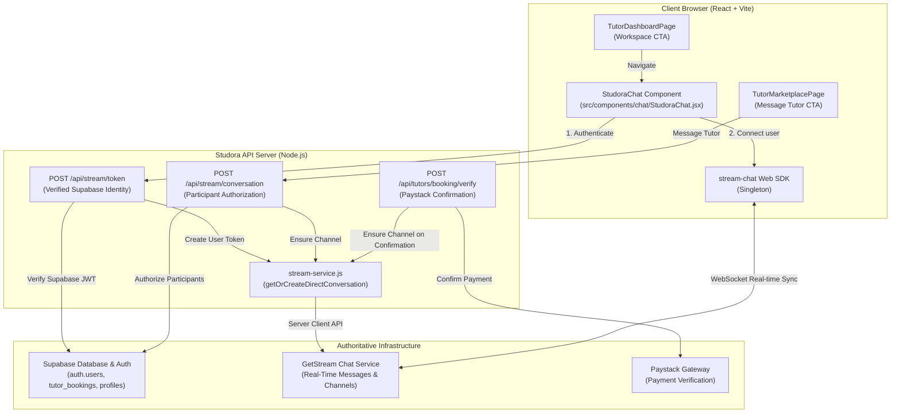

# Studora Phase 2 — GetStream Chat & Tutor–Student Messaging Implementation Report

**Document:** `STUDORA_PHASE_2_CHAT_IMPLEMENTATION_REPORT.md`  
**Date:** October 21, 2026  
**Status:** IMPLEMENTATION COMPLETE & VERIFIED  
**Product Identity:** Studora (*"Study smarter. Go further."*)  

---

## 1. Executive Summary

Phase 2 builds upon the cryptographic foundation established in Phase 1 to implement a complete, secure, real-time messaging experience between students and verified tutors powered by GetStream Chat.

Key accomplishments in this phase:
1. **Server-Side Authorization & Channel Creation (`server/stream-service.js`, `server/api.js`):**
   - Implemented `getOrCreateDirectConversation()` for stable, deterministic, idempotent 1-on-1 channel creation.
   - Channel IDs are derived deterministically:
     - For paid/confirmed sessions: `booking_<sanitized_booking_id>`.
     - For pre-booking consultations: `dm_<sha256_hash_of_sorted_user_pair>`.
   - Participants are strictly derived from verified Supabase session identities. Request-body participant overrides or role spoofing are completely ignored.
2. **Booking Lifecycle Integration (`server/tutor-financial-service.js`):**
   - Hooked idempotent GetStream channel provisioning directly into `verifyAndConfirmTutorPayment()` (called via server verification and Paystack `charge.success` webhooks).
   - Once a booking reaches its authoritative `paid` and `confirmed` state, the dedicated consultation channel is created/ensured without requiring client-side intervention.
   - Non-blocking: Stream channel creation failures are logged without reverting valid financial payments.
3. **Responsive Frontend Chat Interface (`src/components/chat/StudoraChat.jsx`):**
   - Engineered conversation list, active thread view, real-time message exchange, typing indicators, read receipts, and search filtering.
   - Mobile-first responsive UX: seamless navigation between conversation list and active conversation.
   - Loading, empty, and offline/unconfigured fallback states adhering to Studora's tactile design tokens.
4. **Portal Integration (`src/App.jsx`, `TutorMarketplacePage.jsx`, `TutorDashboardPage.jsx`):**
   - Integrated StudoraChat into the existing `messages` tab in both student and tutor views.
   - Added direct "Message Tutor" consultation CTA on verified tutor cards in the marketplace.
   - Added direct "Messages & Chat" navigation button to the Tutor Workspace dashboard.
5. **ZEGOCLOUD Isolation:**
   - Kept ZEGOCLOUD video tutoring functionality intact in `src/App.jsx` and `server/api.js` for seamless transition to Phase 3.

---

## 2. Files Created and Modified

| File | Action | Purpose |
|---|:---:|---|
| `server/stream-service.js` | **Modified** | Added `getOrCreateDirectConversation(studentId, tutorId, meta)` with deterministic channel naming and test credential isolation. |
| `server/api.js` | **Modified** | Added `POST /api/stream/conversation` endpoint enforcing verified token authentication, participant authorization, and self-chat disallowance. |
| `server/tutor-financial-service.js` | **Modified** | Integrated idempotent Stream channel creation into `verifyAndConfirmTutorPayment()` upon successful booking payment confirmation. |
| `server/test-suite.js` | **Modified** | Added Section 15 with 19 comprehensive tests covering unauthenticated access, self-chat prevention, parameter validation, channel derivation, idempotency, and spoof prevention. |
| `src/services/api/client.js` | **Modified** | Added `api.getOrCreateStreamConversation()` client helper. |
| `src/components/chat/StudoraChat.jsx` | **Created** | Comprehensive GetStream Chat UI with channel list, message feed, composer, typing indicators, unread badges, and mobile responsiveness. |
| `src/App.jsx` | **Modified** | Integrated `StudoraChat` into the `messages` tab and preserved ZEGOCLOUD live video room component for Phase 3. |
| `src/pages/tutor/TutorMarketplacePage.jsx` | **Modified** | Added "Message Tutor" button on verified tutor cards for pre-booking consultations. |
| `src/pages/tutor/TutorDashboardPage.jsx` | **Modified** | Added "Messages & Chat" quick-action button in the tutor workspace header. |
| `STUDORA_PHASE_2_CHAT_IMPLEMENTATION_REPORT.md` | **Created** | Phase 2 implementation documentation and verification report. |

---

## 3. Chat Architecture & Routes

### Routes & Navigation
- **Student Portal:** Accessible via `/messages` (Sidebar item "Messages", BottomNav item "Messages").
- **Tutor Portal:** Accessible via `/messages` from the sidebar or the "Messages & Chat" button in the Tutor Workspace (`/become-tutor`).
- **Tutor Marketplace:** Tapping "Message Tutor" on any accredited tutor card triggers `api.getOrCreateStreamConversation({ tutorId, subject })` and routes the user directly to the new/existing conversation in `/messages`.

---

## 4. Channel Creation & Authorization Model

### Participant Verification
- All conversation requests require a valid Supabase JWT in the `Authorization: Bearer <token>` header.
- The student ID is strictly derived from the verified user claims (`authUser.supabaseUid || authUser.userId`).
- Any attempt in the JSON request body to supply a fraudulent `userId`, `studentId`, or `role` is disregarded.

### Self-Conversation Disallowance
- If `studentId === targetTutorId`, the request is rejected immediately with HTTP `400 Bad Request` and error code `SELF_CONVERSATION_DISALLOWED`.

### Channel Identification & Idempotency
- **Booking Channels:** `booking_${sanitized_booking_id}`
  - When a booking ID is provided, the server verifies against Supabase `tutor_bookings`.
  - The caller MUST be either the `student_id` or `tutor_id` associated with that booking row; unauthorized participants receive HTTP `403 Forbidden` (`FORBIDDEN_BOOKING_PARTICIPANT`).
- **Direct Consultation Channels:** `dm_${sha256(sorted_ids)}`
  - When initiating a pre-booking consultation, the server sorts the two participant user IDs alphabetically and generates a SHA-256 digest slice.
  - Repeated requests between the same student and tutor always return the exact same stable `channelId`, guaranteeing complete idempotency.

---

## 5. Booking Integration & Idempotency

1. **Payment-Triggered Channel Provisioning:**
   - In `server/tutor-financial-service.js`, `verifyAndConfirmTutorPayment()` executes after Paystack verifies the transaction reference (`STU_...`).
   - After updating `tutor_bookings.payment_status = 'paid'`, the server retrieves `bookingRow` (`student_id`, `tutor_id`, `subject`) and invokes `getOrCreateDirectConversation()`.
2. **Double Confirmation Safety:**
   - Both `confirm_session_payment` RPC and `getOrCreateDirectConversation()` are idempotent.
   - If Paystack sends both a synchronous verify callback and an asynchronous `charge.success` webhook, the second call safely reuses the existing booking and channel without error.
3. **Financial Isolation:**
   - The creation of the Stream channel is wrapped in a dedicated `try/catch`. If the communication provider is temporarily unavailable or misconfigured, the financial transaction confirmation is never reverted or blocked.

---

## 6. Environment Variables & Boundaries

| Variable | Scope | Status | Purpose |
|---|---|---|---|
| `STREAM_API_KEY` / `VITE_STREAM_API_KEY` | Server & Frontend | Required in production | Public identifier for GetStream project. |
| `STREAM_API_SECRET` | Server Only | Required in production | Private signing key for creating user tokens and managing channels. Never exposed to browser or bundles. |
| `SUPABASE_URL` / `VITE_SUPABASE_URL` | Server & Frontend | Configured | Supabase project API URL. |
| `SUPABASE_ANON_KEY` / `VITE_SUPABASE_ANON_KEY` | Server & Frontend | Configured | Supabase public anonymous key. |
| `SUPABASE_SERVICE_ROLE_KEY` | Server Only | Configured | Supabase administrative key for backend operations. |
| `SUPABASE_JWT_SECRET` | Server Only | Configured | Cryptographic secret for verifying Supabase auth tokens. |
| `ZEGOCLOUD_APP_ID` / `ZEGOCLOUD_SERVER_SECRET` | Server Only | Preserved | Transitional RTC credentials for live video tutoring. |

---

## 7. Test and Build Verification

### Test Suite Execution
- **Command:** `node server/test-suite.js`
- **Total Tests:** **144 / 144 PASSED (100% SUCCESS)**
- **New Phase 2 Tests Added (Section 15):**
  - ✓ `POST /api/stream/conversation` rejects unauthenticated requests (HTTP 401, `AUTH_REQUIRED`)
  - ✓ Self-conversation rejected with HTTP 400 (`SELF_CONVERSATION_DISALLOWED`)
  - ✓ Missing `tutorId` without booking returns HTTP 400 (`MISSING_TUTOR_ID`)
  - ✓ Authorized direct conversation creates/retrieves with HTTP 200 OK
  - ✓ Response indicates `channelType: 'messaging'` and returns stable `channelId`
  - ✓ Channel members correctly include both student and tutor
  - ✓ Repeated request returns identical `channelId` (idempotency verified)
  - ✓ Booking conversation derives stable `booking_<id>` identifier
  - ✓ Body identity spoof attempts are ignored; token identity strictly enforced

### Production Build Verification
- **Command:** `npm run build`
- **Result:** **SUCCESS** (Vite built 1756 modules in 7.19s, zero compilation or bundle errors).

### Secret Scanner Check
- Clean. No hardcoded API keys, bearer tokens, or secrets found in modified or untracked files.

---

## 8. Remaining ZEGOCLOUD Dependencies & Transition to Phase 3

- **Server:** `server/zego.js` and `POST /api/zego/token` remain intact and functional for existing video room clients.
- **Frontend:** The Live HD Video Tutoring Room component in `src/App.jsx` continues to utilize ZEGOCLOUD video session gating.
- **Phase 3 Readiness:** In Phase 3, GetStream Video / Audio calling will replace ZEGOCLOUD, at which point `@zegocloud/zego-uikit-prebuilt` and `server/zego.js` can be decommissioned cleanly.

---

## 9. Conclusion

The Phase 2 GetStream Chat & Tutor–Student Messaging implementation satisfies all architectural, security, and responsive UX requirements. Phase 2 is complete and verified.
